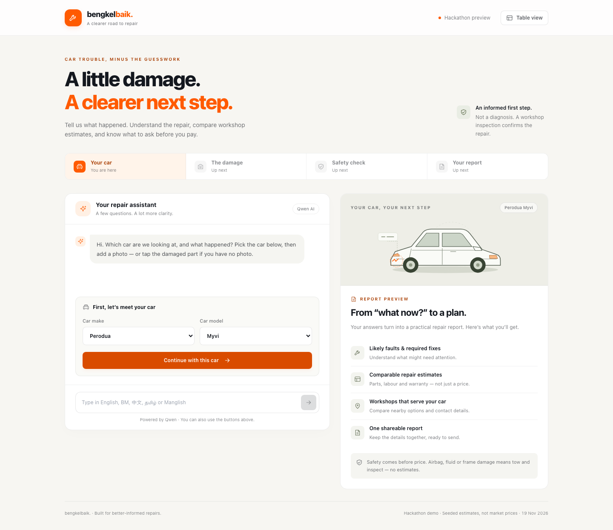
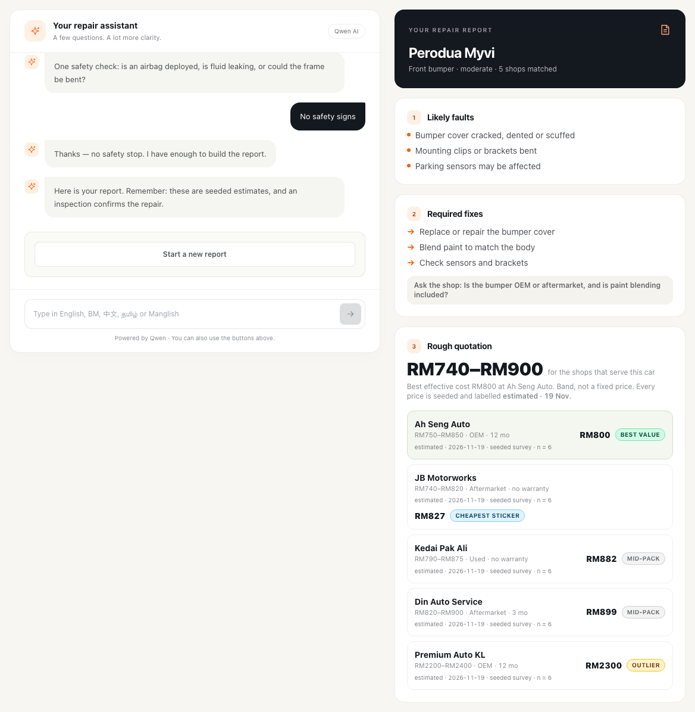

# Bengkel Baik

Photo of visible car damage in, **normalised, comparable workshop quotes** out.

Built for Alibaba Cloud x Developer Kaki QodeFest, 19 Nov 2026 — Digital Inclusion / Public Good.

> **RM800 vs RM780 is not a choice.** Those two quotes price different things: part grade,
> labour, warranty and lead time. We normalise them, so a comparison becomes possible.

**Why a web app, not chat:** the product is the option set — part grade, labour, warranty,
lead time, effective cost and a safety stop, side by side. A chat thread flattens that; a
filterable table makes it comparable at a glance.

## App snapshots

### Guided intake

Car selection, a step-by-step repair assistant and a preview of the report.



### Repair report

After the safety check: likely faults, required fixes and ranked workshop estimates.



Captured from the running app using the manual path: Perodua Myvi · front bumper · moderate damage.
Workshop prices are seeded estimates, not market prices.

## Submission deck

The 10-slide submission deck is at
[`docs/Bengkel-Baik-QodeFest-2026.pptx`](docs/Bengkel-Baik-QodeFest-2026.pptx).
Every figure in it comes from this repo's seeded data and `docs/evidence/`; demo images
are labelled as generated illustrations.

## Run it

```bash
npm install
npm run dev          # http://localhost:3000
npm test             # ranking unit tests
npm run typecheck
npm run build
```

Optional photo analysis:

```bash
cp .env.local.example .env.local
# put DASHSCOPE_API_KEY in .env.local — never commit it
```

Without a key the app still works: the six damage chips are the manual path, and the API
returns a graceful empty result instead of throwing.

## Demo video

[Watch the recorded UI demo (37 seconds, WebM)](docs/BengkelBaik-Demo.webm)

Vehicle selection → live Qwen photo assessment → safety check → repair report.
This is a partial recording; report sharing and the safety-stop branch are not shown.
Prices shown are seeded estimates, not market prices.

[Additional walkthrough video (MOV)](demo/bengkel-baik-demo.mov)

## Demo path

1. Perodua + Myvi, tap **Front bumper** → ranked table appears.
2. Ah Seng Auto (RM800, OEM, 12-month warranty) ranks **above** JB Motorworks
   (RM780 sticker, aftermarket, no warranty) because effective cost includes warranty risk.
3. The Honda/Toyota-only shop is absent — it doesn't serve a Perodua.
4. Premium Auto KL is flagged as an outlier, not silently ranked first.
5. Upload a photo → the damage chip auto-selects, label + confidence appear, and a
   make hint offers **"Detected: Perodua · use this"** — the user confirms; only the
   confirmed make filters shops.
6. Tick the red safety box (or let the model set it) → **Don't drive — tow it**, no prices.

Try `/?offline=1` for the conference-wifi-proof path: local JSON only, cached assessment.

## Data honesty

**Prices are a seeded survey of 6 workshops, 19 Nov 2026.** Every price band carries an
`estimated · 19 Nov` chip and a provenance row. They are estimates to compare, not market
prices. An inspection confirms the repair.

Classification accuracy on real photos has **not been measured yet** — that number belongs
in this README only after we run the six labelled samples with a live API key. Do not invent it.

## What is deliberately not built

Video input, booking, payments, live workshop APIs, maps, accounts, chat history, admin UI,
price scraping, and a live WhatsApp/Telegram integration. The camera cannot see brakes,
air-con or engine faults, so those are not damage classes in this build.

**Brand is a hint, the user is the source of truth.** Qwen may return `suspectedMake`,
which prefills the make dropdown behind a visible "use this" confirm. Only the confirmed
selection feeds `match.ts` — a wrong auto-filter would hide the best-value shop.

## Where things live

- `app/page.tsx` — intake, damage chips, ranked table, safety stop
- `app/api/assess/route.ts` — one Qwen-VL call, zod validation, one retry, graceful empty
- `prompts/assess.ts` — six-class taxonomy and the "never say safe / never price" rules
- `lib/match.ts` — coverage × capability filter (filtered shops are hidden)
- `lib/normalize.ts` — mid price, warranty risk premium, effective cost, outlier, verdict
- `data/` — seeded workshops, quotes, offline cache
- `docs/ARCHITECTURE.md` — pipeline and trade-offs
- `.qoder/skills/create-pr/` — project skill: checks, summary, confirm, then `gh pr create`

## Evidence trail

Commit history is one commit per ticket (`T0`, `A1`–`A5`, `B1`, `C1`–`C2`, `D1`–`D2`),
built with Qoder from the frozen contract in `AGENT.md`.
