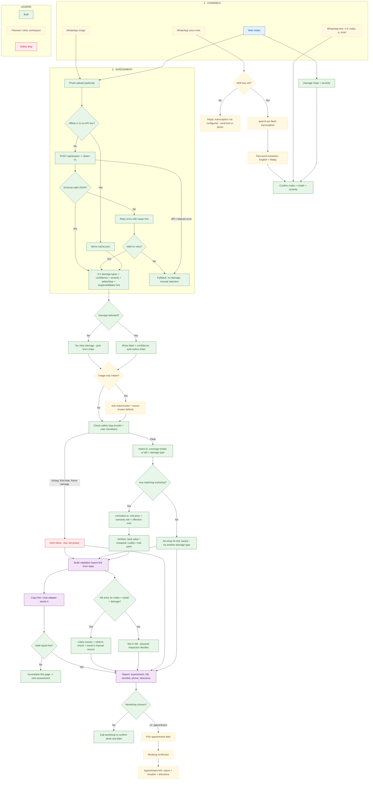

# End-to-end workflow

Status as of 19 Nov 2026. Legend: **built** = in this repo; **planned** = v2 or lives in
the separate WhatsApp workspace.

## Outcome matrix

| Stage | Outcome | Behaviour |
|---|---|---|
| Assessment | 1–2 damage types returned | Label + confidence shown, chips auto-selected |
| Assessment | No damage detected | "No clear damage found. Pick it below." |
| Assessment | Invalid JSON twice | `damageTypes: []`, manual selection |
| Assessment | API / network error | Same manual-selection fallback, no crash |
| Assessment | `?offline=1` or no API key | Cached assessment from `data/demo-cache.json` |
| Safety | Airbag / fluid / frame signal | Tow warning, no prices rendered |
| Matching | No eligible workshop | Explicit message, try another damage type |
| Matching | Eligible workshops | Ranked by effective cost with four verdicts |
| Knowledge base | Myvi / Saga entry exists | Likely causes + inspection checks + manual source |
| Knowledge base | Model outside the KB | "Not in our knowledge base" fallback |
| Report link | Valid state | Full report with phone and directions |
| Report link | Invalid state | Recovery page back to a new assessment |

## Where each piece lives

| Piece | File |
|---|---|
| Intake, chips, quote table | `app/page.tsx` |
| Assessment API | `app/api/assess/route.ts` |
| Matching | `lib/match.ts` |
| Ranking | `lib/normalize.ts` |
| Knowledge base data / lookup | `data/vehicle-kb.json`, `lib/kb.ts` |
| Shareable report state | `lib/report.ts` |
| Report page | `app/report/page.tsx` |
| Copy-link control | `app/report/copy-link.tsx` |

## Share-link contract

`/report?make=<make>&model=<model>&damage=<damage>&severity=<severity>&stop=1&found=<type:conf,...>`

- Validated against `MAKES`, `DAMAGE_TYPES` and `SEVERITIES`; invalid links show a
  recovery page.
- `found` is capped at two entries; confidence is clamped to 0–1.
- Prices are not encoded — they are recomputed deterministically from the seeded data,
  so the link cannot drift from the quote table.

## Not built (planned)

- WhatsApp bot (`bot/whatsapp.mjs`) lives in a separate workspace; it is an I/O-only
  adapter that calls the same `/api/assess`. No workflow platform, SDK or agent runtime.
- Image-only clarification loop (make/model + owner-known defects).
- Appointment booking and appointment link.
- Vehicle KB beyond Perodua Myvi and Proton Saga.

## Manual sources

- Perodua Myvi e-Owner's Manual: <https://eownersmanual.perodua.com.my/ourcars/>
- PROTON Saga Owner's Manual: <https://www.proton.com/after-sales/owners-manual/saga>

The KB is curated seed data, not a diagnosis. Likely causes are common impact/wear
patterns; the inspection checklist is the part intended to be grounded in the manual.
